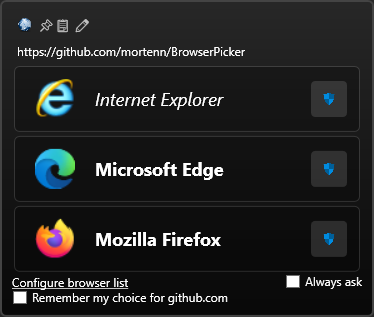

# Browser Picker

Browser Picker is a default browser replacement for Windows. When you open a link outside a browser, it lets you pick which browser (or browser profile) opens it, or it follows rules you set up.

For example, you can open `github.com` in Firefox, `microsoft.com` in Edge, and an old internal app in Internet Explorer, and be asked for everything else.

## Quick start

1. [Install Browser Picker](installation.md) and set it as your default web browser in Windows.
2. Click a link in another app, such as an email. The [picker window](picker.md) opens.
3. Pick a browser. To always use that browser for the site, tick **Remember** before you pick.
4. Open Browser Picker from the Start menu to change [browsers](browsers.md), [rules](rules.md) and [behaviour](behaviour.md).

## Languages

Browser Picker follows the Windows display language. English and Simplified Chinese are included; other languages fall back to English. To contribute a translation, see [Languages](https://github.com/mortenn/BrowserPicker#languages) in the readme.

## Where to get help

- [Troubleshooting](troubleshooting.md) covers the most common problems.
- The **Feedback** tab in the settings window copies a report you can attach to a [GitHub issue](https://github.com/mortenn/BrowserPicker/issues).
