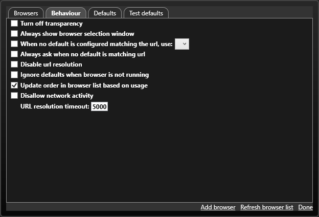

# Behaviour settings

The **Behaviour** tab of the settings window controls how the picker looks and when it appears.

## Appearance

- **Theme** and **Font size** change how Browser Picker looks.
- **Auto size window** fits the picker to its content. Resize the picker window to give it a fixed size; this turns the option off and saves the size.
- **Always open on primary monitor** opens the picker centered on the primary monitor. When it's off, the picker opens on the monitor under the mouse cursor.
- **Turn off transparency** uses a solid background, which can be easier to read. **Window opacity** sets how transparent the window is otherwise.

## List order

Choose **Sort list manually**, **Sort list based on usage** (most-used browsers first) or **Sort list alphabetically**.

## Profile display

- **Group profiles under browser** shows one entry per browser with an expandable profile list.
- **Show profiles as separate entries** shows every profile as its own entry.
- **Remember expanded profile groups between launches** keeps groups open or closed the way you left them.

## When to show the picker

- **Always show browser selection window**: always ask, even when a rule matches. The picker has the same option as **Always ask**.
- **Auto close on focus lost**: close the picker without opening the link when you switch to another window.
- **Always ask when no default is matching URL**: only open links automatically when a [rule](rules.md) matches. Otherwise always show the picker, even if only one browser is running.
- **Use defaults even when browser is not running**: open the rule's (or fallback) browser even when it isn't running. When this is off, the picker appears instead, so you can choose a browser or profile to start.

## Lookup timeout

**URL resolution timeout** sets how long Browser Picker waits when it expands a short link before it gives up.

## When no URL rule matches

Turn on **Use a fallback default browser** and choose a **Fallback browser** to open every link that no rule matches.

## Windows integration

For the portable build, this section registers or unregisters **Browser Picker (Portable)** as a browser for the current user. See [Install and set as default](installation.md#portable-registration).
