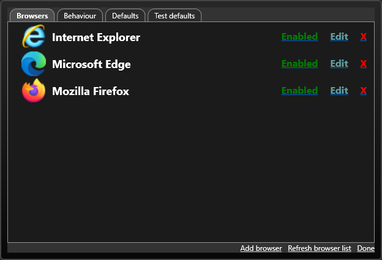
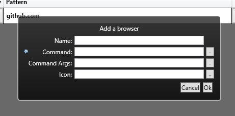
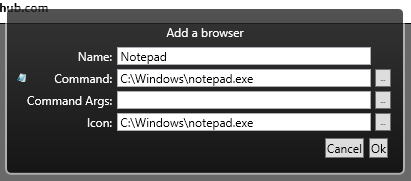
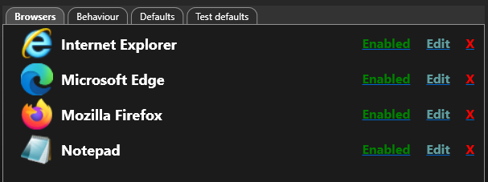

# Browsers and profiles

Open Browser Picker from the Start menu to open the settings window. The **Browsers** tab lists the browsers the picker can show.

## Detected browsers

Browser Picker finds installed browsers from the Windows registry, the same list Windows uses for **Default apps**. It refreshes this list in the background each time it runs, so new browsers appear on their own. **Refresh browser list** runs it immediately.

Browsers Browser Picker knows well get private-mode arguments and profile support automatically: Firefox, Firefox Developer Edition, Zen Browser, Chrome, Chrome Dev, Edge, Internet Explorer, Opera and Vivaldi.

- Click **Enabled** to hide a browser from the picker without removing it.
- The **X** button removes a browser. A detected browser comes back the next time the list is refreshed; disable it instead to keep it out of the picker.
- The **+** button creates a new entry that starts as a copy of this one, for example to launch the same browser with different arguments.

## Add or edit a browser

Select **Add browser**, or **Edit** on an existing entry. You can add any program, not only browsers.

| Field | What it does |
| --- | --- |
| **Name** | The name shown in the picker. Filled in from the executable when you browse for it. |
| **Command** | The program to run. The **...** button opens a file picker. |
| **Command Args** | Arguments added before the URL. Put arguments that contain spaces in double quotes. |
| **Icon** | The icon shown in the picker. Filled in from the executable when you browse for the command. |
| **Expand file:// URLs** | Converts `file://` links to normal local or network paths before launching. |
| **Privacy Args** | Arguments used when you open the browser in private mode. |
| **Disable automatic updates** | Stops Browser Picker from overwriting this entry when it refreshes the detected browser list. |
| **Hotkey** | A key that opens this browser from the picker. Press the key you want; press `Esc` to clear it. |

## Profiles

Browser Picker reads the profiles of Chromium-based browsers (Chrome, Edge, Vivaldi and others) and Firefox-based browsers, and shows them in the picker.

- Chromium profiles and their names come from the browser's `Local State` file.
- Firefox profiles come from `profiles.ini`.
- In the Browsers tab, use the toggle next to each profile to choose whether it appears in the picker.
- In [Behaviour](behaviour.md) > **Profile display**, choose whether profiles are grouped under their browser or shown as separate entries.

If you prefer, you can still create one entry per profile by hand. For Chrome, add `--profile-directory=Default` for the first profile and `--profile-directory="Profile 1"` for the second, and so on, to **Command Args**.

### Firefox and Zen containers

Browser Picker can list Firefox containers, read from `containers.json` in the matched profile, and open links in a container.

1. Edit the Firefox or Zen Browser entry and turn on **Enable container support (Firefox / Zen)**.
2. Refresh the browser list.
3. Install [Open external links in a container](https://addons.mozilla.org/en-US/firefox/addon/open-url-in-container/) in the profile you use. It handles the `ext+container:` links Browser Picker sends; browsers don't understand them without it.

Zen Browser profiles are read from `%AppData%\zen`.
