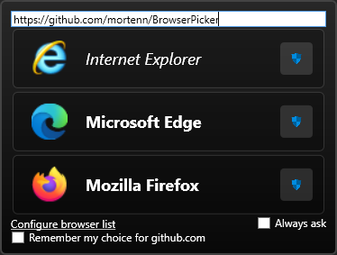

# The picker window

## What happens when you open a link

Browser Picker checks these in order and stops at the first one that applies:

1. If **Always ask** is on, the picker window opens.
2. If a [rule](rules.md) matches the URL, the rule's browser opens it. By default this only happens when that browser is already running. Turn on **Use defaults even when browser is not running** in [Behaviour](behaviour.md) to open it anyway.
3. If exactly one browser is running, the link opens in that browser.
4. If you set a fallback browser in [Behaviour](behaviour.md), it opens the link (with the same "running" condition as rules).
5. Otherwise, the picker window opens.

## The address bar

The top of the window shows the URL that will open.

- **Wrapped links** from Outlook Safe Links, Teams Safe Links and Facebook are unwrapped on your computer, without a network request, so you see the real target.
- **Short links** from known URL shorteners can be expanded to show where they lead. This sends a request to the shortener. See [Security and network lookups](security.md) to change or turn this off.
- The **clipboard** button copies the URL without opening it.
- The **pencil** button lets you edit the URL before you open it.
- The **padlock** button runs a manual [connection check](security.md#manual-connection-check).
- The **pin** button keeps the window open when it loses focus.

## Picking a browser

- Running browsers are shown in **bold**; browsers that aren't running are shown in *italics*.
- Browsers with profiles show a button that expands the profile list. See [Browsers and profiles](browsers.md).
- The shield button opens the browser in private mode, where the browser supports it.
- Tick **Remember** before you pick to create a rule for the host name, or for the whole domain when that option is shown. The next link to that site opens in the same browser without asking.
- For a local or network file, the picker offers **Remember folder** instead. It creates a [Folder rule](rules.md#match-types) for the file's folder and its subfolders.

## Keyboard shortcuts

| Key | Action |
| --- | --- |
| `Enter` or `1` | Open the first browser in the list |
| `2` to `9` | Open the second to ninth browser |
| `Alt` + one of the keys above | Open that browser in private mode |
| `Esc` | Close the picker without opening the link |

You can give a browser its own key in the browser editor (**Hotkey**). See [Browsers and profiles](browsers.md#add-or-edit-a-browser).

If the window loses focus, it closes without opening the link, unless you turned off **Auto close on focus lost** or pinned the window.

## Links at the bottom

- **Always ask** makes the picker open for every link, even when a rule matches.
- **Configure browser list** opens the settings window.
- **Feedback** opens the settings window on the Feedback tab.
