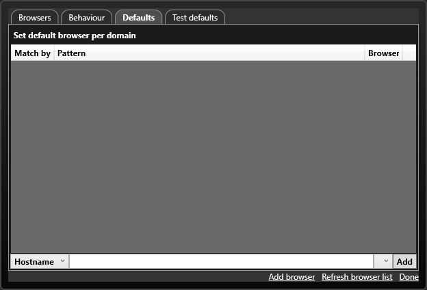
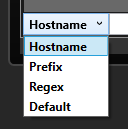
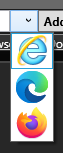
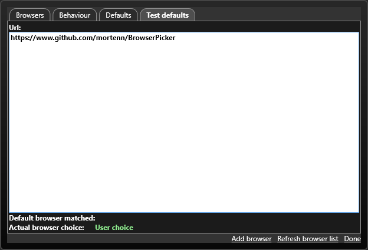

# Rules (Defaults)

Rules send matching URLs straight to a browser, without showing the picker. Manage them in the **Defaults** tab of the settings window, or tick **Remember** in the [picker](picker.md) to create one.

Each rule has a match type, a pattern and a browser. When several rules match a URL, the one with the longest match wins.

## Match types

| Type | Matches | Example pattern | Matches | Doesn't match |
| --- | --- | --- | --- | --- |
| **Hostname** | The end of the host name | `hub.com` | `https://www.github.com/mortenn` | `https://example.com/hub.com` |
| **Prefix** | The start of the URL | `https://github.com/mortenn` | `https://github.com/mortenn/BrowserPicker` | `https://www.github.com/mortenn` |
| **Regex** | A [.NET regular expression](https://learn.microsoft.com/en-us/dotnet/standard/base-types/regular-expressions) run against the URL | `^https://[a-z]+\.example\.com/` | `https://dev.example.com/app` | `https://example.com/` |

**Default** is reserved for the fallback browser and becomes **Hostname** if you select it.

A Hostname pattern matches any host name that ends with it, so `hub.com` also matches `github.com`. Start the pattern with a dot (`.example.com`) to match only subdomains, or use a Regex rule to match one exact host.

## Pick the browser

The rule opens the selected browser. By default the rule only applies when that browser is already running; see **Use defaults even when browser is not running** in [Behaviour](behaviour.md).

## Test your rules

The **Test defaults** section shows which rule matches a URL and which browser would open it. Paste a URL to try it.

## Fallback browser

For URLs that match no rule, you can set a fallback browser in [Behaviour](behaviour.md) > **When no URL rule matches**.
